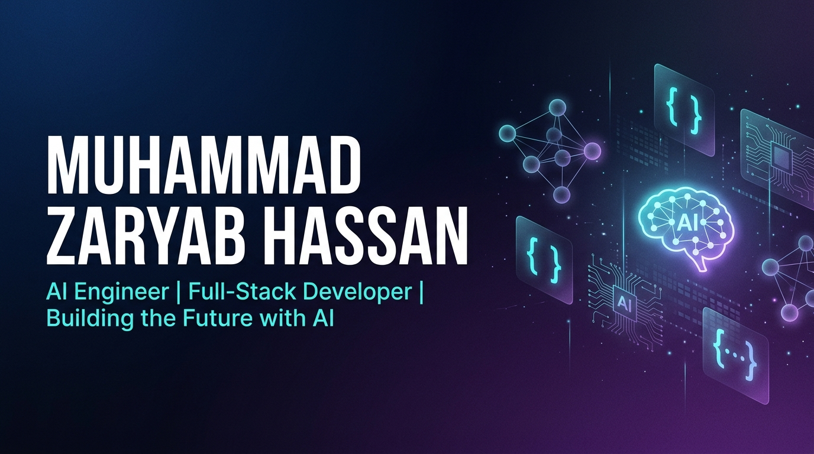

<div align="center">

<!-- BANNER -->


<!-- 3D AVATAR -->
<br/>


<br/><br/>

# 👋 Hi, I'm Muhammad Zaryab Hassan

### 🤖 AI Engineer | 🌐 Full-Stack Developer | 🚀 Building the Future with AI

[](https://www.linkedin.com/in/muhammad-zaryab-hassan-aa0822301)
[](https://portfolio-fawn-kappa-69.vercel.app)
[](mailto:mmzaryabhassan@gmail.com)
[](https://github.com/zaryab124)

<br/>


</div>

---

## 🧠 About Me

```python
class ZaryabHassan:
    def __init__(self):
        self.name = "Muhammad Zaryab Hassan"
        self.role = "AI Engineer & Full-Stack Developer"
        self.languages = ["Python", "TypeScript", "JavaScript", "HTML/CSS"]
        self.interests = ["Artificial Intelligence", "Machine Learning", "Web Development", "AI Agents"]
        self.currently_building = "AI-Powered Applications & Intelligent Agents"
    
    def say_hi(self):
        print("Thanks for visiting my profile! Let's build something amazing together! 🚀")

me = ZaryabHassan()
me.say_hi()
```

- 🔭 I'm currently working on **AI Agents & Enterprise Solutions**
- 🌱 I'm constantly learning **LLMs, RAG, Multi-Agent Systems & Next.js**
- 💡 I love building **AI-powered products that solve real-world problems**
- 📫 Reach me at **mmzaryabhassan@gmail.com**
- ⚡ Fun fact: I turn coffee ☕ into intelligent code 🤖

---

## 🛠️ Tech Stack & Tools

<div align="center">

### 🤖 AI & Machine Learning


### 🌐 Frontend


### ⚙️ Backend & Tools


</div>

---

## 🚀 Featured Projects

<div align="center">

<a href="https://github.com/zaryab124/Impact-StudyAgent">
  
</a>
<a href="https://github.com/zaryab124/IMPACT-Enterprise">
  
</a>

<a href="https://github.com/zaryab124/Xynvora-AI">
  
</a>
<a href="https://github.com/zaryab124/ai-video-transformer">
  
</a>

</div>

### 📂 All Active Projects

| Project | Description | Tech | Live Demo |
|---------|------------|------|-----------|
| 🤖 [Impact-StudyAgent](https://github.com/zaryab124/Impact-StudyAgent) | AI-Powered Study Agent | TypeScript | [🔗 Live](https://studyagent-one.vercel.app) |
| 🏢 [IMPACT-Enterprise](https://github.com/zaryab124/IMPACT-Enterprise) | Enterprise Solutions Platform | TypeScript | [🔗 Live](https://impact-enterprise.vercel.app) |
| 🧠 [Xynvora-AI](https://github.com/zaryab124/Xynvora-AI) | AI-Powered Platform | TypeScript | [🔗 Live](https://xynvora-ai.vercel.app) |
| 💼 [Business Portal](https://github.com/zaryab124/bussinessportal) | Business Management Portal | JavaScript | [🔗 Live](https://bussinessportal-six.vercel.app) |
| 📖 [Khadijah-Tul-Qubrah](https://github.com/zaryab124/Khadijah-Tul-Qubrah-by-Meer-Mus) | Digital Book Platform | TypeScript | [🔗 Live](https://khadijah-tul-qubrah-by-meer-mus.vercel.app) |
| 🏏 [Cricket Scoring](https://github.com/zaryab124/cricket-scoring-) | Live Cricket Score Tracker | TypeScript | [🔗 Live](https://cricket-scoring-cyan.vercel.app) |
| 🍽️ [OK Restaurant](https://github.com/zaryab124/ok-restuerent) | Restaurant Management System | TypeScript | [🔗 Live](https://ok-restuerent.vercel.app) |
| ⚽ [Digital Sports](https://github.com/zaryab124/digital-sports) | Digital Sports Platform | TypeScript | [🔗 Live](https://digital-sports.vercel.app) |
| 💻 [Digitalos](https://github.com/zaryab124/Digitalos) | Digital OS Experience | TypeScript | [🔗 Live](https://digitalos-eight.vercel.app) |
| 🎥 [AI Video Transformer](https://github.com/zaryab124/ai-video-transformer) | Photo to Video AI Tool | Python | — |
| 📷 [Camera Calculator](https://github.com/zaryab124/cameracalculator) | CCTV Coverage Calculator | HTML | — |

---

## 📊 GitHub Stats

<div align="center">


<br/>


</div>

---

## 🏆 GitHub Trophies

<div align="center">


</div>

---

## 📈 Contribution Graph

<div align="center">


</div>

---

## 🤝 Let's Connect & Collaborate!

<div align="center">

💬 I'm open to **freelance projects**, **collaborations**, and **AI consulting opportunities**.

If you have an exciting project or idea, don't hesitate to reach out!

<br/>

[](mailto:mmzaryabhassan@gmail.com)
[](https://portfolio-fawn-kappa-69.vercel.app)

<br/><br/>

---


</div>
